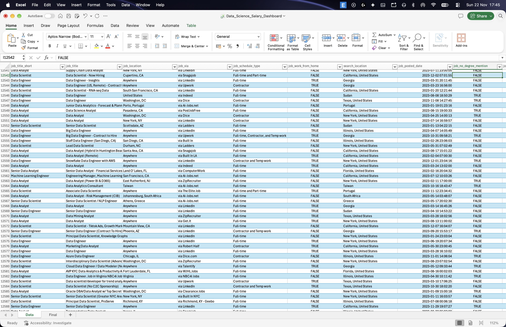

# 📊 Data Science Job Market & Salary Analysis (Excel Dashboard)

## 📌 Project Overview

  
👀 Click to view Raw Dataset Sample (12,500+ rows)

   
  

This project analyzes a dataset of **12,500+ data-related job postings** to uncover key trends in compensation, job roles, employment types, and recruitment channels. The goal is to build an interactive Excel Dashboard that helps job seekers and recruiters make data-driven decisions.

## 🎯 Business Questions Answered
1. **Compensation Benchmarks:** How do median salaries compare across different data roles (e.g., Data Analyst vs. Data Scientist vs. Data Engineer)?
2. **Work Type Impact:** How does employment type (Full-time, Contractor, Part-time, Internship) affect median pay?
3. **Geographic & Platform Trends:** Which countries have the highest demand, and which job platforms dominate recruitment?

## 🛠️ Tools & Excel Techniques Used
* **Data Cleaning & Preparation:** Handled missing values, standardized job titles (`job_title_short`), formatted timestamps (`job_posted_date`), and structured raw data into an official Excel Table.
* **Dynamic Formulas & Functions:** Used `MEDIAN`, `COUNTIFS`, `INDEX/MATCH` (or `XLOOKUP`), and dynamic drop-down lists (Data Validation) to power interactive KPI cards.
* **Data Visualization:** Built dynamic Bar Charts, Filled Map charts, and conditional formatting highlights that automatically update based on user filters.

## 🔍 Key Insights (Example: Data Analyst | United States | Full-time)
* **Median Salary:** Full-time Data Analysts in the US earn a median salary of **$90,000**.
* **Role Hierarchy:** Senior Data Scientists and Software/Data Engineers command the highest median salaries ($130k–$150k+), while entry/mid-level Data Analysts and Business Analysts sit around the $85k–$95k range.
* **Employment Type:** Full-time and Contractor roles offer significantly higher median compensation compared to Part-time and Internship positions.
* **Top Recruitment Channel:** Platforms like **Snagajob**, **LinkedIn**, and **Indeed** account for the highest volume of job postings (1,730 filtered listings for this segment).

## 🚀 How to Use
1. Download the `Data_Science_Salary_Dashboard.xlsx` file from this repository.
2. Open it in Microsoft Excel (enable macros/content if prompted).
3. Use the yellow drop-down selectors (**Job Title**, **Country**, and **Type**) at the top of the `Final` sheet to dynamically filter all charts and KPI cards.
